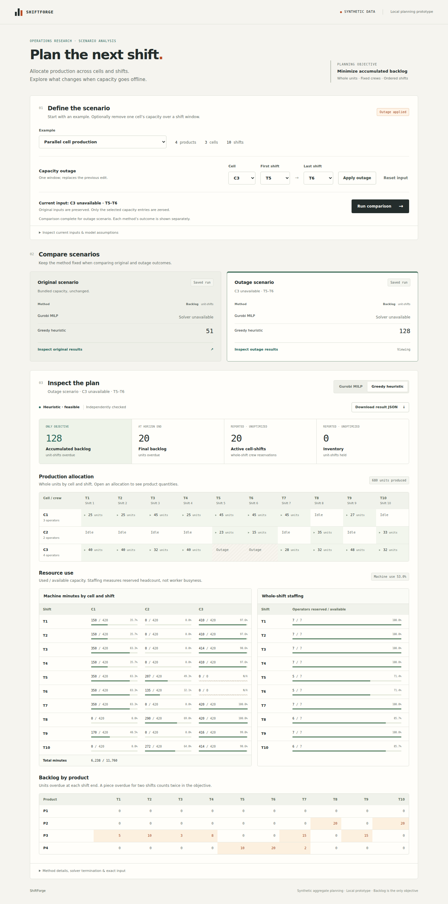

# ShiftForge

**Plan production across cells and shifts when machine capacity and operators are limited.** ShiftForge combines a native Java 21 planning service with a React dashboard for comparing synthetic equipment-outage scenarios.

The Java backend implements a deterministic greedy dispatcher, a Gurobi mixed-integer optimization model, strict JSON validation, and an arithmetic result checker. Backlog is the only optimized measure; inventory and active cells are descriptive. This is aggregate allocation with fictional inputs, not a detailed machine schedule or a deployed factory system.



## Run without a solver license

Requirements: **JDK 21 or newer**, internet access for the first Maven build, and Node 24 for the dashboard. The checked-in Maven wrapper downloads Maven 3.9.11 with a pinned checksum; a system Maven installation is unnecessary. On Windows use `mvnw.cmd` in place of `./mvnw`.

```bash
./mvnw verify
java -jar target/shiftforge.jar solve --example lookahead --algorithm greedy --output artifacts/greedy.json
java -jar target/shiftforge.jar check artifacts/greedy.json
```

The lookahead example returns `heuristic_feasible`, objective **1**, and a valid independent arithmetic check. Greedy planning and the default test suite do not initialize Gurobi.

Start the API:

```bash
java -jar target/shiftforge.jar serve
```

In another terminal:

```bash
cd frontend
npm ci --ignore-scripts
npm run dev
```

Open **http://127.0.0.1:5173** on the server's machine. Vite proxies `/api` to the Java service on port **8012**. For a remote host, forward port 5173 through your normal SSH connection. To serve the built dashboard directly, run `npm run build` in `frontend`, then:

```bash
java -jar target/shiftforge.jar serve --ui frontend/dist
```

Open **http://127.0.0.1:8012**. There is no Python runtime dependency.

## Gurobi optimization

The official Java API is pinned to **Gurobi 14.0.0**, using Maven coordinate `com.gurobi:gurobi`. Its default package includes native libraries for supported platforms. A **suitable local Gurobi license** is still required; a working Python installation does not establish that Java has a usable license. See [Gurobi's Java installation guide](https://support.gurobi.com/hc/en-us/articles/19474118568977-How-do-I-install-Gurobi-for-Java) and [Java API documentation](https://docs.gurobi.com/projects/optimizer/en/current/reference/java/overview.html).

Configure your license using Gurobi's normal installation procedure. If applicable, point to your own existing license file before starting the process:

```bash
export GRB_LICENSE_FILE="/absolute/path/to/your/gurobi.lic"
java -jar target/shiftforge.jar solve --example tiny --algorithm gurobi --output artifacts/tiny.json
java -jar target/shiftforge.jar check artifacts/tiny.json
./mvnw -Pgurobi -DrequireGurobi=true test
```

Never put license files or credentials in this repository. A missing/incompatible license returns `solver_unavailable`, HTTP **503**, with no optimizer solution. It never silently switches to greedy. The dashboard still displays the separately requested greedy result. Early termination with a checked incumbent is `feasible`; `optimal` requires optimal termination, zero configured gap tolerances, a consistent bound and checked output.

**Verification limit:** no Java-capable Gurobi license was available during implementation. The Java model compiles against the real API, and actual initialization was tested to return the explicit unavailable response. Native optimization outcomes have **not** been verified here. Opt-in solver tests cover expected objectives and edge cases; they skip visibly without a license, or fail when `-DrequireGurobi=true` is supplied. Historical Python optimizer results used by UI replay tests are labeled separately and are not Java solve results.

## Try a disruption

1. Select the base example and run the original scenario comparison.
2. Apply a C3 outage in shifts 5–6, then run the edited input.
3. Compare the checked greedy result, or both methods when Gurobi is available.
4. Inspect allocation, inventory, crew reservations and the exact input snapshot.
5. Download the result. Editing the dashboard later marks existing output stale and does not rewrite its saved input.

```bash
java -jar target/shiftforge.jar solve --example base --algorithm greedy --outage-cell C3 --outage-start 5 --outage-end 6 --output artifacts/outage.json
java -jar target/shiftforge.jar example tiny --output artifacts/input.json
java -jar target/shiftforge.jar validate artifacts/input.json
java -jar target/shiftforge.jar help
```

`check` recomputes feasibility, objective arithmetic and metrics; it does not independently certify optimality or authenticate externally edited solver metadata. The Gurobi time limit applies to optimization, not environment setup, model construction or a hard HTTP deadline. A browser timeout does not cancel native work.

## Architecture

| Component | Responsibility |
| --- | --- |
| `Domain`, `Inputs`, `ScenarioData` | Immutable records, strict integer-only boundaries, full matrix/reference validation and indexes |
| `GreedyPlanner` | Solver-free, deterministic due-demand dispatch |
| `GurobiOptimizer` | Native Java formulation, bounded integer decisions, optimization and raw-state extraction |
| `Plans` | Dense reporting and solver-independent arithmetic validation |
| `PlanningService` | Shared CLI/API logic and honest solver termination/status interpretation |
| `PlannerServer`, `Main` | Java HTTP API and CLI; no framework or Python subprocess |
| `frontend` | React/TypeScript dashboard, captured-input comparison and exact-input JSON exports |

Inputs are bounded to eight products, six cells and twenty shifts. Quantities are strict integers: booleans, numeric strings, fractions, unknown fields, duplicate keys and incomplete capacity/demand matrices are rejected. Results preserve raw solver activity and stock states so the checker can detect inconsistencies.

The API binds to loopback by default. Each server process has one nonblocking planning slot; concurrent solve requests receive **409**. Request bodies are limited to 1 MiB. The optional container listens on all interfaces inside the container; publish it only on host loopback as shown below. No authentication, persistent database, distributed locking, job queue, multi-process coordination or restart recovery is claimed.

### HTTP API

- `GET /api/health` — process health.
- `GET /api/examples` — validated base, tiny and lookahead scenarios.
- `POST /api/solve` — `{ "scenario": { ... }, "algorithm": "greedy", "solver_time_limit_seconds": 10 }`.

Invalid requests receive **422**, a busy planner **409**, unavailable Gurobi **503**, and failed/invalid solver output **500**. Successful results include `input`, `algorithm`, checked `status`, metrics and optional solver metadata. `algorithm` defaults to `gurobi`; the time limit defaults to ten seconds and must be an integer from 1 to 60.

## Tests

```bash
./mvnw verify                            # license-free tests, then executable JAR
./mvnw -Pgurobi test                     # also attempts native tests; inspect skips
./mvnw -Pgurobi -DrequireGurobi=true test # requires real native solves
cd frontend
npm run build
npx playwright install --with-deps chromium
npm run test:e2e
```

The JUnit suite covers strict inputs, five complete Python-reference greedy exports, infeasible/tampered results, solver status interpretation, HTTP error responses, concurrency and lock recovery. Browser replay tests exercise stale snapshots, exact downloads and mismatched/failing responses. CI runs the license-free Java suite, a real greedy CLI solve/check, dashboard build and browser replay tests on Java 21/Node 24.

See [model and provenance](docs/model-and-provenance.md) for equations and source boundaries, and [verification](docs/verification.md) for actual checks and limitations. No benchmark speedup, production scale or optimizer performance claim is made for this implementation.

## Container

```bash
docker build -t shiftforge .
docker run --rm -p 127.0.0.1:8012:8012 shiftforge
```

The image builds the frontend and backend, runs default Java tests, and serves both from Java as an unprivileged user. Gurobi still needs a valid license supplied separately at runtime; none is baked into the image. Container configuration is provided, with actual execution status recorded in the verification notes.

## Origin and contribution status

ShiftForge adapts George Trump's [Factory Capacity Planner](https://github.com/gergetrump/factory-capacity-planner) into a separate native Java backend. The mathematical problem, synthetic examples, dashboard and historical UI replay fixtures derive from that project; it is one evolving portfolio project, not unrelated independent work. The Java service, validation, result checking, CLI and tests were implemented with substantial Codex assistance. George's personal walkthrough and independent modification of this implementation have not yet been established. The original project remains separate and unchanged.
